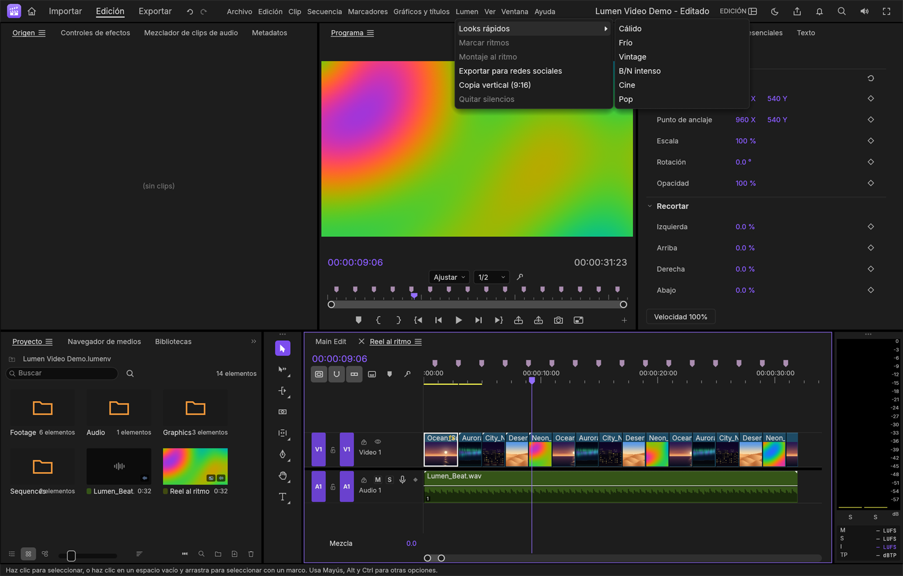
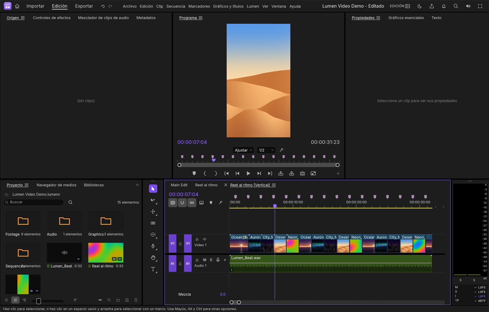
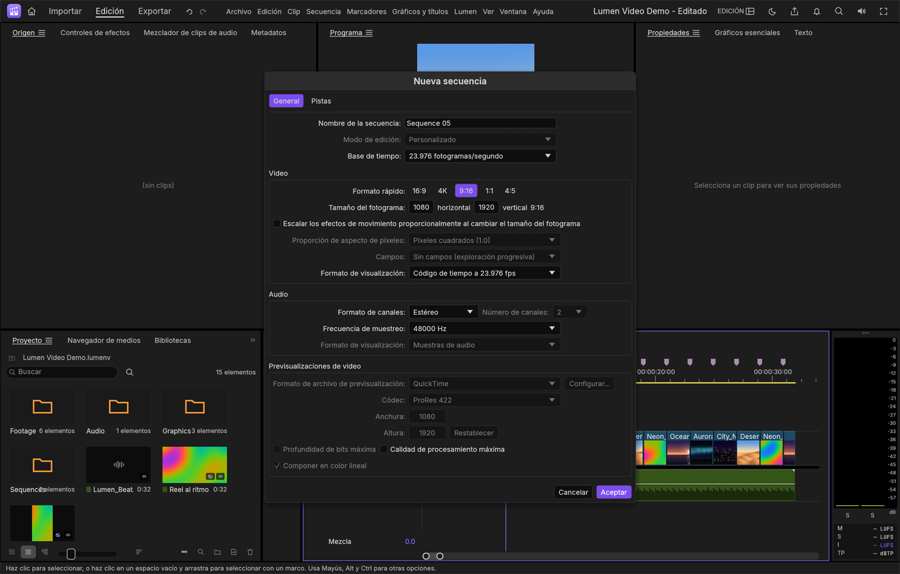
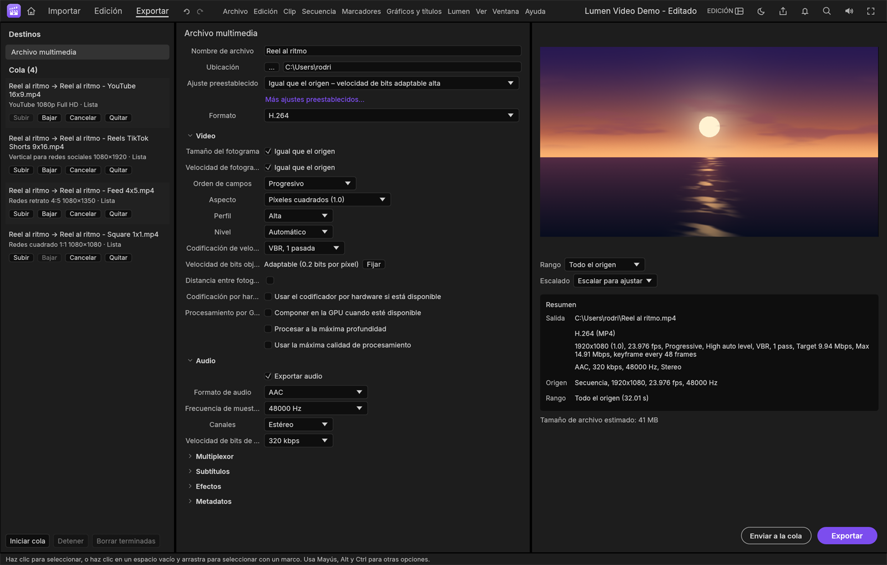
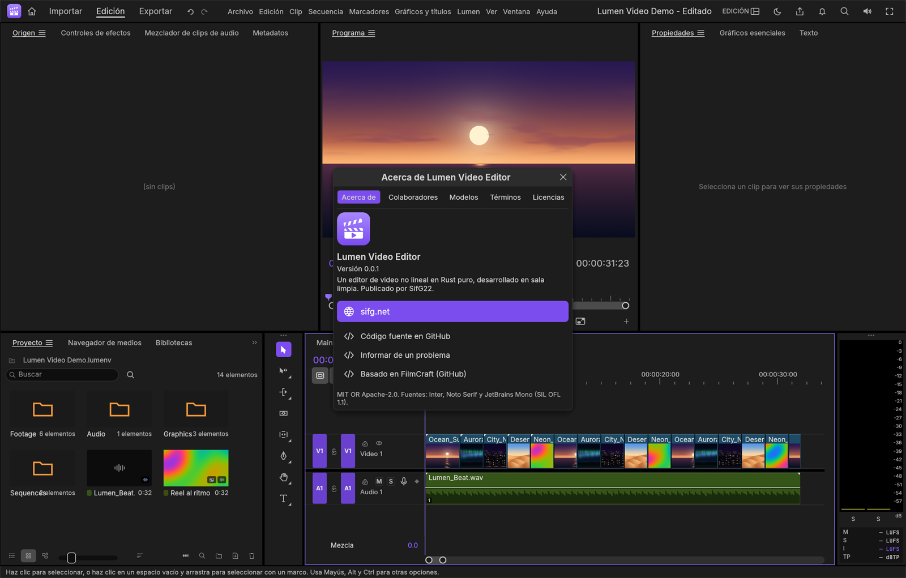

<div align="center">


# Lumen Video Editor

**El editor de vídeo para Windows rápido, nativo, gratuito y sin suscripciones.**
Montaje profesional, color, audio, títulos y subtítulos, más herramientas propias pensadas para creadores:
**montaje al ritmo de la música, quitar silencios de un clic, copia vertical para Reels y exportación a todas las redes a la vez.**

Hecho por [**SifG22**](https://sifg.net).

[](https://github.com/SifG22/lumen_video_editor/releases/latest)
[](https://github.com/SifG22/lumen_video_editor/releases)


### [⬇ Descargar para Windows](https://github.com/SifG22/lumen_video_editor/releases/latest) · [sifg.net](https://sifg.net) · [Términos](assets/legal/TERMINOS.txt) · [Novedades](packaging/lumen/NOVEDADES.md)



</div>

---

## 📑 Contenido

- [Solo en Lumen Video: el menú Lumen](#-solo-en-lumen-video-el-menú-lumen)
- [Cómo se usa cada herramienta](#-cómo-se-usa-cada-herramienta)
- [Todo lo que puedes hacer](#-todo-lo-que-puedes-hacer)
- [Descargar e instalar](#️-descargar-e-instalar)
- [Actualizaciones automáticas](#-actualizaciones-automáticas)
- [Preguntas frecuentes](#-preguntas-frecuentes)
- [Compilar desde el código](#️-compilar-desde-el-código)
- [Términos, licencias y créditos](#-términos-licencias-y-créditos)

---

## 🚀 Solo en Lumen Video: el menú **Lumen**

Herramientas propias de SifG22 para quien crea vídeo para redes, YouTube, vlogs, tutoriales o pódcast. Están juntas en el menú **Lumen**, entre «Gráficos y títulos» y «Ver».

| | |
|---|---|
| 🥁 **Montaje al ritmo** | Elige una canción y tus clips: Lumen Video detecta el tempo y monta una secuencia con un corte en cada compás. Un reel listo en un segundo. |
| 🎵 **Marcar ritmos** | Un marcador en cada pulso (o cada 2 o 4) de la música, para cortar a mano justo en el golpe. |
| ✂️ **Quitar silencios** | Elimina de un clic las pausas de una toma de voz, en todas las pistas a la vez para no perder la sincronía, dejando un respiro natural entre frases. |
| 📱 **Copia vertical (9:16)** | Convierte tu montaje horizontal en vertical 1080×1920 con cada plano llenando el encuadre, sin rehacer nada. |
| 📤 **Exportar para redes sociales** | Un clic y se exporta tu secuencia en YouTube 16:9, Reels/TikTok/Shorts 9:16, feed 4:5 y cuadrado 1:1, cada una con su archivo. |
| 🎨 **Looks rápidos** | Cálido, Frío, Vintage, B/N intenso, Cine y Pop. Probar uno tras otro los sustituye en vez de apilarlos. |

Y además, al crear una secuencia, los botones de **Formato rápido** (16:9, 4K, 9:16, 1:1, 4:5) ponen el tamaño exacto que pide cada plataforma.

<table>
<tr>
<td width="50%"><br><sub><b>Copia vertical (9:16)</b>: el montaje horizontal convertido a 1080×1920, cada plano llenando el encuadre.</sub></td>
<td width="50%"><br><sub><b>Formato rápido</b>: el tamaño de cada red en un clic al crear la secuencia.</sub></td>
</tr>
<tr>
<td width="50%"><br><sub><b>Exportar para redes sociales</b>: cuatro formatos en la cola de exportación de una vez.</sub></td>
<td width="50%"><br><sub><b>Ayuda › Acerca de</b>: versión, enlaces, términos y licencias.</sub></td>
</tr>
</table>

## 📖 Cómo se usa cada herramienta

<details open>
<summary><b>🥁 Montaje al ritmo</b> — de una canción y unos clips a un reel montado</summary>

1. **Archivo › Importar** tu canción y tus vídeos o fotos.
2. En el panel **Proyecto**, selecciona la canción y los clips (Ctrl + clic). El orden en que los eliges es el orden en que aparecerán.
3. **Lumen › Montaje al ritmo**.

Se crea una secuencia nueva con la música en A1 y un corte en cada compás (cada 4 pulsos). Los clips se van turnando y cada uno continúa donde se quedó la vez anterior, así que no se repite el mismo trozo. Las fotos duran lo que dura su hueco. Todo es **un solo paso de deshacer**.
</details>

<details>
<summary><b>🎵 Marcar ritmos</b> — marcadores en cada golpe de la música</summary>

Selecciona un clip de música en la línea de tiempo y elige **Lumen › Marcar ritmos**. Aparece un marcador violeta «♪» en cada pulso, y verás el tempo detectado (BPM). Si lo vuelves a usar, sustituye los marcadores anteriores en lugar de duplicarlos. Con el imán activado, los cortes se pegan a los marcadores.
</details>

<details>
<summary><b>✂️ Quitar silencios</b> — jump cuts automáticos para vlogs, tutoriales y pódcast</summary>

Selecciona el clip con la voz (o su vídeo enlazado) y elige **Lumen › Quitar silencios**. Lumen Video busca las pausas de más de 0,6 s por debajo de −42 dB y las quita **en todas las pistas**, para que vídeo, voz y música sigan sincronizados. Deja 0,12 s de aire a cada lado para que las frases no suenen cortadas, y no toca las respiraciones cortas. Si algo no te convence, **Ctrl + Z** lo deshace todo de una vez.
</details>

<details>
<summary><b>📱 Copia vertical (9:16)</b> — tu vídeo horizontal listo para Reels, TikTok y Shorts</summary>

Con la secuencia horizontal abierta, elige **Lumen › Copia vertical (9:16)**. Se crea «<nombre> (Vertical)» a 1080×1920 con cada plano escalado para llenar el encuadre y centrado; si habías hecho zoom en un plano, lo conserva. Tu secuencia original no se toca. Después puedes recolocar cada plano desde **Propiedades › Posición**.
</details>

<details>
<summary><b>📤 Exportar para redes sociales</b> — todos los formatos de una vez</summary>

Con la secuencia abierta, elige **Lumen › Exportar para redes sociales**. Se añaden a la cola de exportación cuatro archivos MP4 (H.264) y empiezan a exportarse:

| Archivo | Para | Tamaño |
|---|---|---|
| `<secuencia> - YouTube 16x9.mp4` | YouTube, Vimeo, TV | 1920×1080 |
| `<secuencia> - Reels TikTok Shorts 9x16.mp4` | Reels, TikTok, Shorts, Historias | 1080×1920 |
| `<secuencia> - Feed 4x5.mp4` | Publicaciones de Instagram y Facebook | 1080×1350 |
| `<secuencia> - Square 1x1.mp4` | Publicaciones cuadradas | 1080×1080 |

Puedes ver el progreso en **Exportar** (arriba a la izquierda).
</details>

<details>
<summary><b>🎨 Looks rápidos</b> — color de cine en un clic</summary>

Selecciona uno o varios clips de vídeo y elige **Lumen › Looks rápidos** › *Cálido, Frío, Vintage, B/N intenso, Cine* o *Pop*. Cada look es un Lumetri Color normal, así que puedes retocarlo después en el panel Lumetri. Si pruebas otro look, sustituye al anterior. También están en **Efectos › Ajustes preestablecidos de Lumetri › Looks rápidos**, con miniaturas.
</details>

## ✨ Todo lo que puedes hacer

| | |
|---|---|
| 🎬 **Montaje de verdad** | Línea de tiempo con varias pistas de vídeo y audio, recortes de rizo, rodillo, deslizamiento, multicámara, marcadores, anidado y grupos. |
| 🎨 **Color** | Lumetri Color completo: corrección básica, curvas, ruedas de color, HSL secundario, viñeta, LUT, ámbitos (forma de onda, vectorscopio, histograma) y los **Looks rápidos** de Lumen. |
| 🔊 **Audio** | Mezclador de pistas, sonido esencial (diálogo, música, efectos), efectos de audio, medidores de sonoridad LUFS y atenuación automática de la música bajo la voz. |
| ✍️ **Títulos y subtítulos** | Texto y formas animables, gráficos esenciales, subtítulos SRT, VTT y SCC, y transcripción opcional en tu propio equipo. |
| ✨ **Efectos y transiciones** | Desenfoques, nitidez, claves de color, máscaras animables, transiciones de vídeo y audio, y fotogramas clave en cualquier parámetro. |
| 📂 **Abre de todo** | MP4, MOV, MKV, WebM, AVI, MXF, ProRes, H.264, HEVC, VP9, AV1, imágenes, secuencias de imágenes y audio. Decodificación por hardware en Windows. |
| 🔁 **Intercambio** | EDL, Final Cut Pro XML, FCPXML, OpenTimelineIO y AAF para llevar tus montajes a otros programas. |
| 💾 **Proyectos `.lumenv`** | Guardan todo para seguir editando, con autoguardado y recuperación si algo falla. También abre los proyectos `.fcproj`. |
| 🌍 **En tu idioma** | Español, inglés, portugués, francés, italiano, alemán, japonés, coreano, chino, indonesio, ruso y ucraniano. |
| 🔄 **Se actualiza solo** | Te avisa cuando sale una versión nueva y se instala con un clic. |
| 🔒 **Tus vídeos son tuyos** | Funciona sin conexión y no envía tus vídeos ni tus datos a ningún sitio. |

## ⬇️ Descargar e instalar

1. Entra en la **[última versión](https://github.com/SifG22/lumen_video_editor/releases/latest)** y descarga el instalador de tu PC:

   | Tu PC | Instalador | Portable (sin instalar) |
   |---|---|---|
   | La mayoría (Intel o AMD) | [`LumenVideo-Setup-x64.exe`](https://github.com/SifG22/lumen_video_editor/releases/latest/download/LumenVideo-Setup-x64.exe) | `LumenVideo-<versión>-windows-x64.zip` |
   | Windows en ARM (Snapdragon, Surface Pro X / 11) | [`LumenVideo-Setup-arm64.exe`](https://github.com/SifG22/lumen_video_editor/releases/latest/download/LumenVideo-Setup-arm64.exe) | `LumenVideo-<versión>-windows-arm64.zip` |

   ¿No sabes cuál? Configuración › Sistema › Información › *Tipo de sistema*. Si pone «procesador basado en ARM», el ARM64; si no, el x64.
2. Abre el archivo y pulsa **Instalar**. No pide permisos de administrador. Lumen Video aparece en el menú Inicio y ya puedes borrar el archivo descargado.
3. Si Windows muestra **«Windows protegió su PC»**, pulsa *Más información* › *Ejecutar de todas formas*. Sale porque la app aún no está firmada digitalmente.

| | |
|---|---|
| **Requisitos** | Windows 10 (1809) u 11 de 64 bits, 8 GB de RAM (16 GB para 4K) y una gráfica compatible con DirectX 12 o Vulkan. |
| **Versión portable** | Descomprime el `.zip` y abre `LumenVideo.exe`. Con un archivo vacío `portable.txt` al lado, los ajustes se guardan en la carpeta `data` (ideal para un USB). |
| **Archivos** | El instalador asocia los proyectos `.lumenv` (y `.fcproj`) para abrirlos con doble clic, y añade Lumen Video a «Abrir con» para MP4, MOV, MKV y WebM. |
| **Desinstalar** | Configuración › Aplicaciones › Lumen Video Editor. |

Cada descarga tiene su huella SHA-256 en un archivo `.sha256` al lado, por si quieres comprobarla.

## 🔄 Actualizaciones automáticas

Lumen Video consulta, como mucho **una vez al día**, el aviso de la última versión publicada:

```
https://github.com/SifG22/lumen_video_editor/releases/latest/download/latest.json
```

```json
{
  "version": "0.0.2",
  "notes": "Novedades de la versión…",
  "x64":   { "url": "https://github.com/…/LumenVideo-Setup-0.0.2-x64.exe",   "sha256": "…" },
  "arm64": { "url": "https://github.com/…/LumenVideo-Setup-0.0.2-arm64.exe", "sha256": "…" }
}
```

Si hay una versión más nueva, te lo pregunta en tu idioma. Si aceptas, descarga el instalador de tu arquitectura, **comprueba su SHA-256** y lo ejecuta. Si tienes cambios sin guardar, te pregunta antes de cerrarse. Si dices que no, no vuelve a insistir con esa versión. Los instaladores descargados se borran solos. Para desactivarlo, define la variable de entorno `LUMEN_VIDEO_NO_UPDATE=1`.

## ❓ Preguntas frecuentes

<details>
<summary><b>¿Es gratis? ¿Lleva marcas de agua?</b></summary>

Es gratis, también para trabajos profesionales, y no añade marcas de agua. Los vídeos que creas son tuyos.
</details>

<details>
<summary><b>¿Abre mis proyectos de Premiere Pro?</b></summary>

Todavía no abre `.prproj`, pero puedes pasar secuencias como Final Cut Pro XML, AAF u OpenTimelineIO. Lumen Video no está afiliado a Adobe.
</details>

<details>
<summary><b>¿Necesita internet?</b></summary>

No. Solo consulta si hay actualizaciones (ver arriba). Las funciones opcionales que usan modelos, como la transcripción, descargan el modelo una vez y luego trabajan sin conexión en tu equipo.
</details>

<details>
<summary><b>¿Qué es un archivo .lumenv?</b></summary>

El formato de proyecto de Lumen Video: guarda el montaje entero (secuencias, efectos, títulos, mezcla) para seguir editándolo o compartirlo. Los vídeos no van dentro: el proyecto apunta a tus archivos, así que pesa muy poco. Si mueves los vídeos de sitio, Lumen Video te ayuda a volver a enlazarlos.
</details>

<details>
<summary><b>¿Se me puede perder el trabajo si se cierra de golpe?</b></summary>

No debería: Lumen Video guarda un autoguardado cada pocos minutos en la carpeta `Auto-Save` junto al proyecto, y además un registro de recuperación. Si se cierra de forma inesperada, al abrirlo de nuevo te ofrece **recuperar los cambios no guardados**.
</details>

<details>
<summary><b>He encontrado un fallo o tengo una idea</b></summary>

Abre un [*issue*](https://github.com/SifG22/lumen_video_editor/issues) en este repositorio o cuéntamelo en [sifg.net](https://sifg.net). Si es un fallo, indica tu versión (Ayuda › Acerca de), tu Windows y qué pasos llevan a él. Los registros están en Ayuda › Mostrar archivos de registro.
</details>

## 🛠️ Compilar desde el código

Necesitas [Rust](https://rustup.rs) y las *Build Tools* de Visual Studio 2022 (carga de trabajo «Desarrollo para el escritorio con C++»; en ARM, también las herramientas ARM64).

```bat
:: abrir la app compilada en modo desarrollo
cargo lumen

:: ZIP portable, instalador (necesita Inno Setup 6) y latest.json en dist\
powershell -ExecutionPolicy Bypass -File packaging\lumen\empaquetar.ps1 -Instalador
powershell -ExecutionPolicy Bypass -File packaging\lumen\empaquetar.ps1 -Arch arm64 -Instalador
```

| Dónde | Qué hay |
|---|---|
| [`crates/engine/src/lumen_tools.rs`](crates/engine/src/lumen_tools.rs) | Las herramientas del menú Lumen (con sus tests en `lumen_tools_tests.rs`) |
| [`crates/ui-egui/src/brand.rs`](crates/ui-egui/src/brand.rs) | Nombre, versión, enlaces, términos y licencias de la app |
| [`updater.rs`](apps/lumen/src/updater.rs) | El actualizador automático |
| [`packaging/lumen/`](packaging/lumen/) | Empaquetado, instalador (Inno Setup) y notas de cada versión |
| [`assets/app-icon/`](assets/app-icon/) | El icono en todos sus tamaños |
| [`docs/`](docs/) | Documentación técnica: arquitectura, protocolo de control, pruebas |

**Publicar una versión:** sube `VERSION` en `crates/ui-egui/src/brand.rs`, añade sus novedades a [`packaging/lumen/NOVEDADES.md`](packaging/lumen/NOVEDADES.md) y crea la etiqueta (`git tag v0.0.2 && git push origin v0.0.2`). GitHub Actions ([`lumen-release.yml`](.github/workflows/lumen-release.yml)) compila x64 y ARM64, genera los instaladores, el ZIP portable y el `latest.json`, y publica la Release. Las apps ya instaladas se actualizan solas. Los tests se pasan en Windows con cada cambio ([`lumen-tests.yml`](.github/workflows/lumen-tests.yml)).

## 📜 Términos, licencias y créditos

- El uso de Lumen Video Editor se rige por los **[términos y condiciones de SifG22](assets/legal/TERMINOS.txt)**, que también se muestran al instalar y en Ayuda › Acerca de › Términos.
- Los nombres **Lumen Video** y **Lumen Video Editor** y su marca son de SifG22. El icono de la app es obra de SifG22 y se distribuye con la licencia de [`assets/app-icon/LICENSE.txt`](assets/app-icon/LICENSE.txt).
- Lumen Video Editor es software de código abierto con **licencia MIT** ([LICENSE-MIT](LICENSE-MIT), [NOTICE](NOTICE)); los avisos de copyright que exige esa licencia están en esos archivos. Modificaciones e icono, copyright (c) 2026 [SifG22](https://sifg.net).
- Las fuentes (Inter, Noto Serif, JetBrains Mono, bajo SIL OFL 1.1), las traducciones y demás componentes de terceros, con sus licencias, están en [ATTRIBUTION.md](ATTRIBUTION.md). El instalador los incluye en la carpeta `licencias`.
- Lumen Video no contiene código, iconos, presets ni LUT de Adobe, ni código GPL o LGPL. No está afiliado ni respaldado por Adobe.

<sub>Adobe y Premiere Pro son marcas comerciales o registradas de Adobe Inc. Instagram, Facebook, TikTok, YouTube y X son marcas de sus respectivos propietarios. Lumen Video Editor es un proyecto independiente; esos nombres solo se usan para describir los formatos y flujos de trabajo con los que es compatible.</sub>

---

<div align="center">


**Lumen Video Editor** · Hecho con cariño por **[SifG22](https://sifg.net)**

</div>
